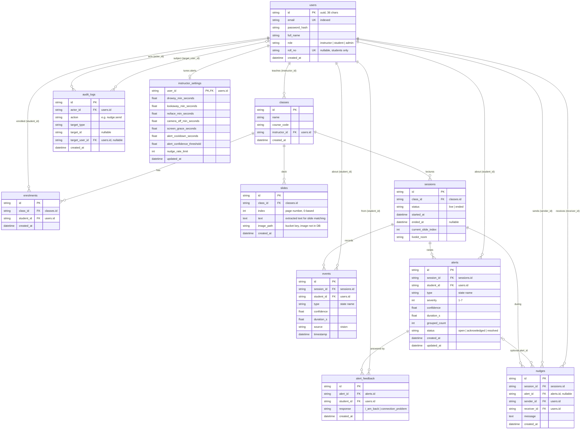

# erd.md: Entity-Relationship Diagram

Source of truth: the SQLAlchemy models in `backend/app/models/` and the Alembic migration in `backend/migrations/`. Eleven tables. Development runs on SQLite (`backend/intelliclass.db`); production targets PostgreSQL with pgvector (Supabase), task DB-02. Every primary key is a 36-character UUID string generated by the app, and every timestamp is timezone-aware UTC.

**Privacy rule (rules.md):** no table stores video frames, photos or screenshots. `slides.image_path` is the key of a PNG rendered from the instructor's own PDF in a private Supabase Storage bucket; `events` stores state changes, not per-second features.

Renders on GitHub. For a PNG for the report, paste the block below into https://mermaid.live and export.

## Tables

### users

Instructors, students and admins. One table for all roles; RBAC reads `role`.

| Column | Type | Key / constraint | Notes |
|---|---|---|---|
| `id` | String(36) | PK | UUID generated by the app |
| `email` | String(255) | unique, indexed | Login name |
| `password_hash` | String(255) |  | Hashed password, never the plain text |
| `full_name` | String(120) |  |  |
| `role` | String(20) | indexed | instructor, student or admin |
| `roll_no` | String(40) | unique, nullable | Set for students; instructors enrol by roll number |
| `created_at` | DateTime(tz) |  | UTC |

### classes

A course taught by one instructor.

| Column | Type | Key / constraint | Notes |
|---|---|---|---|
| `id` | String(36) | PK |  |
| `name` | String(160) |  | e.g. Computer Vision 101 |
| `course_code` | String(40) |  |  |
| `instructor_id` | String(36) | FK users.id, indexed | Owner of the class |
| `created_at` | DateTime(tz) |  |  |

### enrolments

Which students belong to which class. Unique on (class_id, student_id).

| Column | Type | Key / constraint | Notes |
|---|---|---|---|
| `id` | String(36) | PK |  |
| `class_id` | String(36) | FK classes.id, indexed |  |
| `student_id` | String(36) | FK users.id, indexed |  |
| `created_at` | DateTime(tz) |  |  |

### slides

One row per page of the uploaded PDF deck. Unique on (class_id, index).

| Column | Type | Key / constraint | Notes |
|---|---|---|---|
| `id` | String(36) | PK |  |
| `class_id` | String(36) | FK classes.id, indexed |  |
| `index` | Integer |  | Page number, 0-based |
| `text` | Text |  | Extracted text, used for slide matching and later for RAG |
| `image_path` | String(400) |  | Storage key `slides/<class_id>/<index>.png` of the rendered PNG in the private Supabase bucket (a file path with the local backend); the image itself is not in the database |
| `created_at` | DateTime(tz) |  |  |

### sessions

One live lecture of a class. Model class is LiveSession.

| Column | Type | Key / constraint | Notes |
|---|---|---|---|
| `id` | String(36) | PK | Also used as the WebSocket room |
| `class_id` | String(36) | FK classes.id, indexed |  |
| `status` | String(20) | indexed | live or ended |
| `started_at` | DateTime(tz) |  |  |
| `ended_at` | DateTime(tz) | nullable | Set when the instructor ends the class |
| `current_slide_index` | Integer |  | Last slide.changed value, default 0 |
| `livekit_room` | String(80) |  | LiveKit room name, empty when video is off |

### events

A state change observed for a student. Per-second feature packets are not stored.

| Column | Type | Key / constraint | Notes |
|---|---|---|---|
| `id` | String(36) | PK |  |
| `session_id` | String(36) | FK sessions.id, indexed |  |
| `student_id` | String(36) | FK users.id, indexed |  |
| `type` | String(32) | indexed | attentive, sleepy, looking_away, no_face, camera_off, wrong_screen, uncertain, connection_problem |
| `confidence` | Float |  | 0 to 1 from the classifier |
| `duration_s` | Float |  | How long the previous state lasted |
| `source` | String(32) |  | vision (default); later: screen, connection |
| `timestamp` | DateTime(tz) |  |  |

### alerts

Raised by the alert engine when a state persists past its window. Grouped repeats bump grouped_count.

| Column | Type | Key / constraint | Notes |
|---|---|---|---|
| `id` | String(36) | PK |  |
| `session_id` | String(36) | FK sessions.id, indexed |  |
| `student_id` | String(36) | FK users.id, indexed |  |
| `type` | String(32) | indexed | Same state names as events |
| `severity` | Integer |  | sleepy 7, no_face 6, wrong_screen 5, looking_away 4, camera_off 3, uncertain 2, connection_problem 1 |
| `confidence` | Float |  |  |
| `duration_s` | Float |  | Persistence when the alert fired |
| `grouped_count` | Integer |  | Default 1; incremented for repeats inside the cooldown |
| `status` | String(20) | indexed | open, acknowledged (nudge sent) or resolved (student replied I am back) |
| `created_at` | DateTime(tz) |  |  |
| `updated_at` | DateTime(tz) |  | Refreshed on every change |

### nudges

A private message from the instructor to one student. Rate-limited and audited.

| Column | Type | Key / constraint | Notes |
|---|---|---|---|
| `id` | String(36) | PK |  |
| `session_id` | String(36) | FK sessions.id, indexed |  |
| `alert_id` | String(36) | FK alerts.id, nullable | The alert the nudge answers, if any |
| `sender_id` | String(36) | FK users.id | Instructor |
| `receiver_id` | String(36) | FK users.id, indexed | Student |
| `message` | Text |  | e.g. Please focus |
| `created_at` | DateTime(tz) |  |  |

### alert_feedback

The student's one-tap reply to a nudge, tied to the alert it concerns.

| Column | Type | Key / constraint | Notes |
|---|---|---|---|
| `id` | String(36) | PK |  |
| `alert_id` | String(36) | FK alerts.id, indexed |  |
| `student_id` | String(36) | FK users.id |  |
| `response` | String(32) |  | i_am_back (resolves the alert) or connection_problem |
| `created_at` | DateTime(tz) |  |  |

### audit_logs

Who viewed or acted on whose data. Written for every sensitive read and action.

| Column | Type | Key / constraint | Notes |
|---|---|---|---|
| `id` | String(36) | PK |  |
| `actor_id` | String(36) | FK users.id, indexed | Who did it |
| `action` | String(64) | indexed | session.start, session.end, class.enrol, consent.grant, alerts.view, report.view, nudge.send, nudge.reply.i_am_back, nudge.reply.connection_problem |
| `target_type` | String(32) |  | session, class, alert, nudge, report ... |
| `target_id` | String(36) | nullable | Row the action touched |
| `target_user_id` | String(36) | FK users.id, nullable | Whose data was touched |
| `created_at` | DateTime(tz) |  |  |

### instructor_settings

An instructor's saved alert preferences from the Settings page. Applied to sessions that instructor starts after saving; absent means the defaults in `Settings`.

| Column | Type | Key / constraint | Notes |
|---|---|---|---|
| `user_id` | String(36) | PK, FK users.id | One row per instructor; no row means the global defaults |
| `drowsy_min_seconds` | Float |  | Eyes closed this long before a sleepy alert |
| `lookaway_min_seconds` | Float |  | Head turned away this long before an alert |
| `noface_min_seconds` | Float |  | No face in frame this long before an alert |
| `camera_off_min_seconds` | Float |  | Camera off this long before an alert |
| `screen_grace_seconds` | Float |  | Time on another tab or window before a wrong-screen alert |
| `alert_cooldown_seconds` | Float |  | Repeats inside this window are grouped, not re-alerted |
| `alert_confidence_threshold` | Float |  | Alerts below this confidence are held back (0.3 to 0.95) |
| `nudge_rate_limit` | Integer |  | Nudges allowed per student per 10 minutes |
| `updated_at` | DateTime(tz) |  | Refreshed on every save |

## Relationships

| Relationship | Via | Meaning |
|---|---|---|
| users 1 → * classes | `instructor_id` | An instructor owns many classes. |
| users 1 → * enrolments ← * classes | `student_id, class_id` | Many-to-many between students and classes, one row per pair. |
| classes 1 → * slides | `class_id` | One deck per class; re-upload replaces the rows. |
| classes 1 → * sessions | `class_id` | Each live lecture is a session. |
| sessions 1 → * events, alerts, nudges | `session_id` | Everything observed during a lecture hangs off its session. |
| users 1 → * events, alerts, alert_feedback | `student_id` | The student the row is about. |
| alerts 1 → * alert_feedback | `alert_id` | A student's reply is stored against the alert. |
| alerts 0..1 → * nudges | `alert_id` | A nudge may answer an alert or be sent freely. |
| users 1 → * nudges (twice) | `sender_id, receiver_id` | Instructor to student. |
| users 1 → * audit_logs (twice) | `actor_id, target_user_id` | Actor and, when relevant, the subject. |
| users 1 → 0..1 instructor_settings | `user_id` | Optional per-instructor alert tuning. |

## Value sets

- **users.role:** instructor, student, admin.
- **sessions.status:** live, ended.
- **events.type / alerts.type:** attentive, sleepy, looking_away, no_face, camera_off, wrong_screen, uncertain, connection_problem (`app/services/alert_engine/states.py`). Only sleepy, looking_away, no_face, camera_off and wrong_screen can raise alerts; the rest are display-only.
- **alerts.severity:** sleepy 7, no_face 6, wrong_screen 5, looking_away 4, camera_off 3, uncertain 2, connection_problem 1, attentive 0.
- **alerts.status:** open → acknowledged (instructor sent a nudge) → resolved (student replied i_am_back).
- **alert_feedback.response:** i_am_back, connection_problem.
- **audit_logs.action:** session.start, session.end, class.enrol, consent.grant, alerts.view, report.view, nudge.send, nudge.reply.i_am_back, nudge.reply.connection_problem, profile.update, password.change, preferences.update, preferences.reset, slides.remove, class.delete.

## Planned additions (Phase 5)

transcripts, summaries and chunks (text + pgvector embedding) per session for the lecture assistant (tasks AI-06 to AI-09); screen-compliance scores will arrive as `events` with `source = screen` (FE-12/BE-09).
